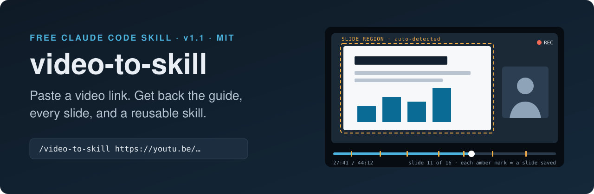
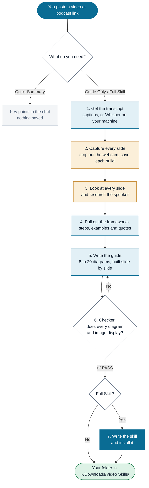
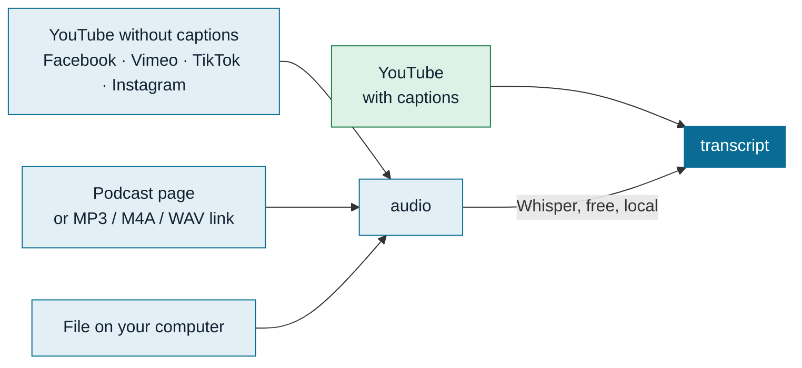
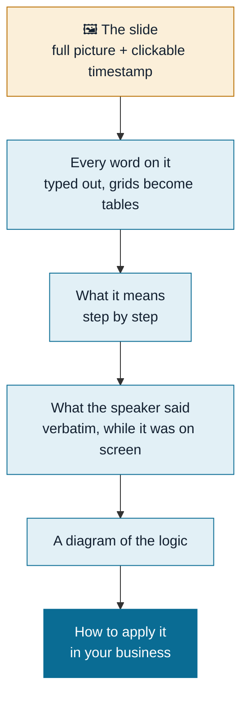

<p align="center">
  
</p>

<p align="center">
  <a href="LICENSE"></a>
  <a href="https://claude.com/claude-code"></a>
  
  
</p>

<p align="center">
  <b>Turn any YouTube video, podcast, webinar or talk into a full written guide with diagrams,<br>
  a screenshot of every slide, and (if you want) a Claude skill that applies what the expert taught.</b>
</p>

<p align="center">
  <a href="#install">Install</a> ·
  <a href="#how-it-works">How it works</a> ·
  <a href="#what-you-get">What you get</a> ·
  <a href="skills/video-to-skill/README.md">Full docs</a> ·
  <a href="https://www.gregkowalczyk.com/skills/video-to-skill/">gregkowalczyk.com</a>
</p>

---

## Install

You need [Claude Code](https://claude.com/claude-code). Then type these two lines in Claude Code:

```
/plugin marketplace add kowalcg/skills
/plugin install video-to-skill@greg-skills
```

Restart Claude Code and run it:

```
/video-to-skill https://www.youtube.com/watch?v=...
```

<details>
<summary><b>Other ways to install</b> (copy the folder, Windows, no git)</summary>

macOS / Linux:
```bash
git clone https://github.com/kowalcg/skills.git
mkdir -p ~/.claude/skills
cp -R skills/skills/video-to-skill ~/.claude/skills/
```

Windows (PowerShell):
```powershell
git clone https://github.com/kowalcg/skills.git
New-Item -ItemType Directory -Force "$HOME\.claude\skills" | Out-Null
Copy-Item -Recurse "skills\skills\video-to-skill" "$HOME\.claude\skills\"
```

No git? Click **Code → Download ZIP** at the top of this page, unzip, and copy
`skills/video-to-skill` into `~/.claude/skills/`. The file must end up at
`~/.claude/skills/video-to-skill/SKILL.md`.

Updates (plugin install): `/plugin marketplace update greg-skills`
</details>

<details>
<summary><b>What else it needs</b> (Python, ffmpeg, optional Whisper)</summary>

```bash
pip3 install youtube-transcript-api markdown      # transcript + guide
brew install ffmpeg yt-dlp && pip3 install numpy Pillow   # slide capture (recommended)
pip3 install openai-whisper                       # optional: podcasts and videos without captions
```

Claude offers to install these the first time it needs them. Windows and Linux: get ffmpeg from
ffmpeg.org and yt-dlp from github.com/yt-dlp. Full list in the
[skill README](skills/video-to-skill/README.md#install-about-90-seconds).
</details>

---

## How it works

You paste a link. It asks how much you want, then runs the whole job on your machine:



### Three modes

| | **Full Skill** *(default)* | **Guide Only** | **Quick Summary** |
|---|:---:|:---:|:---:|
| Transcript | ✅ | ✅ | ✅ |
| Every slide captured | ✅ | ✅ | |
| Full guide with diagrams (HTML + Markdown) | ✅ | ✅ | |
| A new Claude skill, installed for you | ✅ | | |
| Best for | a method you'll use again and again | training, SOPs, reference | "is this worth my hour?" |

### Works with almost any source



No API keys. Captions take seconds; Whisper transcribes an hour of audio in a few minutes.

### Why it captures the slides

The transcript paraphrases. The slides don't. A speaker says "about a third" while the slide says
31.4%. So on every video it downloads the picture, finds the slide area next to the webcam, and
saves each distinct slide with the words spoken while it was up.

| It handles | How |
|---|---|
| Webcam beside the slides | Finds the part of the screen that stays still and crops to it |
| Slides that build up | New picture when part of the slide changes and stays changed for 2 s |
| Flipping back to an earlier slide | Logged, not saved twice |
| Hover pop-ups | Held 2 s or more, saved |
| Missing pages | When slides say "11 / 16", checks every page was caught: `deck page check: 16/16 ✅` |
| Text on the slide | Read with Apple Vision on a Mac; on Windows/Linux Claude reads the pictures |

### What every slide becomes in the guide



Around that, the guide adds who the speaker is, what has changed since the video was recorded,
the tools mentioned with costs and cheaper alternatives, a checklist, common mistakes, a
first-week plan, key quotes and every source used.

---

## What you get

```
~/Downloads/Video Skills/Email Copywriting That Converts/
├── email-copywriting-guide.html   ← open this, works offline
├── email-copywriting-guide.md     edit or paste elsewhere
├── transcript.txt
├── slides/
│   ├── slide_001_00m42s.png
│   ├── slide_002_03m10s.png  …
│   ├── SLIDES.md                  index: picture, timestamp, slide text, what was said
│   └── contact_sheet.jpg          every slide on one page
├── SKILL.md                       Full Skill only
└── README.md
```

In Full Skill mode the new skill is also copied to `~/.claude/skills/<topic>/`. Next session, type
its name or just describe the task, and Claude applies the expert's method to your work.

**The quality bar:** a reference document, not a summary. 8,000 to 12,000 words for a full
methodology, 8 to 20 colour-coded diagrams, and a checker that must pass before you're told it's
done. Nothing outside `~/Downloads/Video Skills/` is touched, and it asks before installing a skill.

---

## More skills

| Skill | What it does | Version |
|---|---|---|
| [video-to-skill](skills/video-to-skill/) | Video or podcast → guide, slides and a reusable skill | 1.1 |

More are coming, one per *AI for Business* meetup in Hamilton and Oakville, Ontario.
**Want the next one?** Leave your name on the
[video-to-skill page](https://www.gregkowalczyk.com/skills/video-to-skill/) and I'll let you know.

Made by **Greg Kowalczyk** · [gregkowalczyk.com](https://www.gregkowalczyk.com) ·
Questions: [contact](https://www.gregkowalczyk.com/contact/) · MIT licence, use it however you like.
